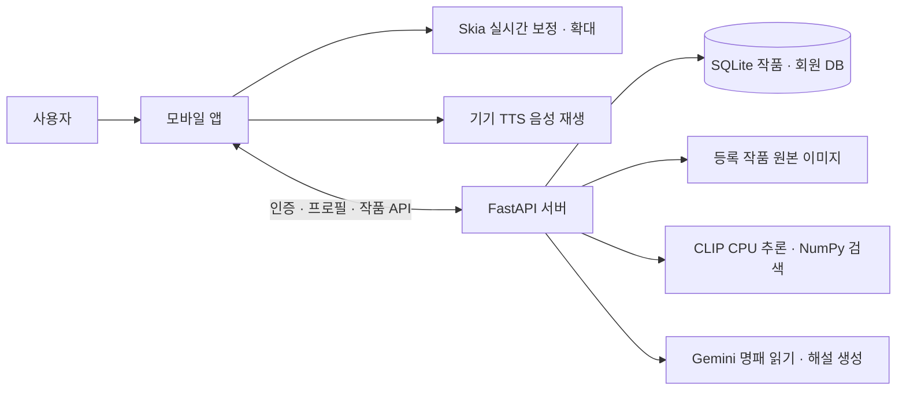

# SWAITHON

### 사용자 시각 특성에 맞춘 예술 감상 앱

저시력·색각이상 사용자가 작품의 색채, 명암, 형태와 세부 표현을 더 편하게 감상할 수 있도록 돕는 모바일 앱입니다.
사용자별 시각 설정을 바탕으로 작품 이미지를 보정하고 확대하며, 시각적 특징과 가능한 감정적 해석을 구분한 음성 해설을 제공합니다.

현재 개발 중이며, **FE 기능 검증 화면과 BE API가 구현된 단계**입니다. 앱 전체 흐름의 연동은 진행 전입니다.

## 핵심 기능

| 기능 | 설명 |
|---|---|
| 회원가입·로그인 | 계정에 시각 프로필과 관람 기록을 연결합니다. |
| 개인 시각 프로필 | 색각 관련 설정, 대비·밝기·선명도·보정 강도와 감상 선호를 관리합니다. |
| 사용자 맞춤 이미지 보정 | 앱에서 설정에 맞춰 이미지를 실시간으로 보정하고 원본 보기로 전환합니다. |
| 작품 확대 | 핀치 줌과 확대·축소 버튼으로 세부 요소를 살펴봅니다. |
| 작품·명패 인식 | 촬영한 작품을 등록 카탈로그와 비교하거나 명패의 제목·작가를 읽어 후보를 찾습니다. |
| 맞춤 음성 해설 | 객관적 시각 정보와 감정적 해석을 구분하고, 선택한 감상 모드의 해설을 음성으로 재생합니다. |
| 관람 기록 | 감상한 작품과 당시 보정 설정을 계정별로 저장합니다. |

색각 유형별 보정 모델, 시각 프로필 생성 방식, 영역 터치 설명, 분위기 기반 음악은 추가 검토·구현 대상입니다.

## 감상 흐름

1. 회원가입·로그인 후 개인 시각 설정을 저장합니다.
2. 등록 작품을 선택하거나 작품·명패를 촬영합니다.
3. 인식 결과에서 작품을 확인하고 등록된 원본 이미지를 불러옵니다.
4. 앱이 사용자 설정에 맞춰 이미지를 보정하고 확대 기능을 제공합니다.
5. 원하는 감상 모드의 해설을 듣고 관람 기록을 저장합니다.

등록 작품의 고화질 원본은 사용자 맞춤 보정을 적용할 바탕 이미지입니다.
미등록 작품은 촬영본을 활용하는 경로로 설계되어 있으며, 서버의 실시간 분석 결과는 미검수 상태로 구분합니다.

## 구성

아래는 FE·BE 연동 구조입니다. 현재 인증·프로필·인식 API와 앱 화면 사이의 통합 작업은 남아 있습니다.



- **FE:** 카메라·업로드, 접근성 UI, 실시간 이미지 보정·확대, TTS를 담당합니다.
- **BE:** 회원 인증, 계정 설정·관람 기록, 작품 카탈로그·원본 제공, 인식·해설 API를 담당합니다.
- **AI:** 모델·데이터 검증, 인식 성능 평가, 해설 품질 검토와 자체 학습 모델 개발을 담당합니다.

사용자 촬영본은 서버에서 검증·전처리와 인식·분석에 사용하고 영구 저장하지 않습니다.
작품 카탈로그 원본과 회원별 설정·관람 기록은 서버에 저장합니다.

## 기술 스택

| 구분 | 현재 사용 기술 |
|---|---|
| 모바일 | TypeScript, React Native, Expo SDK 58, Expo Router |
| 이미지 표시·보정 | React Native Skia, Gesture Handler, Reanimated |
| 촬영·전처리·음성 | Expo Camera, Expo Image Manipulator, Expo Speech |
| 서버 | Python 3.12, FastAPI, Uvicorn |
| 데이터 | SQLite, NumPy 임베딩 인덱스 |
| 회원 인증 | Argon2 비밀번호 해시, 만료·폐기 가능한 Bearer 세션 |
| 이미지 처리 | Pillow, pillow-heif |
| 작품 인식 | PyTorch, OpenCLIP ViT-B/32 계열, 코사인 유사도 검색 |
| 명패·해설 | Gemini API, RapidFuzz 텍스트 매칭 |
| 배포 구성 | Docker, CPU 서버용 실행 설정 |

## 로컬 실행

Node.js·npm, Python 3.12, uv가 필요합니다. 모바일 확인에는 Expo Go를 사용합니다.

### 1. 백엔드 실행

프로젝트 최상위에서 실행합니다. 가상환경 생성은 최초 한 번만 수행합니다.

```bash
cd Backend
uv venv --python 3.12 .venv
uv pip install --python .venv/bin/python -r requirements.txt
./.venv/bin/python import_catalog.py catalog.demo.json
./.venv/bin/python -m uvicorn main:app --reload --host 0.0.0.0
```

- [API 문서](http://127.0.0.1:8000/docs)
- [서버 상태](http://127.0.0.1:8000/health)
- [등록 작품 목록](http://127.0.0.1:8000/artworks)

포함된 모나리자 이미지는 로컬 연동 확인용 데모입니다. 실제 고화질 카탈로그 구축은 별도로 진행합니다.

작품 사진 인식을 사용하려면 다른 터미널에서 `Backend`로 이동한 뒤 의존성과 검색 인덱스를 준비합니다.

```bash
uv pip install --python .venv/bin/python -r requirements-ai.txt
./.venv/bin/python build_index.py
```

최초 실행 시 모델 가중치를 내려받습니다. 작품 이미지나 모델 설정이 바뀌면 인덱스를 다시 생성합니다.

### 2. 프론트엔드 실행

새 터미널의 프로젝트 최상위에서 실행합니다.

```bash
cd Frontend
npm ci
npm start
```

Expo Go로 접속해 **Spike** 탭에서 보정·확대·TTS·촬영 기능을 확인할 수 있습니다.
기존 FE 스파이크의 업로드 시험에는 아래 환경변수를 사용합니다. `<PC_IP>`는 같은 네트워크에 있는 개발 PC의 내부 IP로 바꿉니다.

```bash
EXPO_PUBLIC_UPLOAD_URL="http://<PC_IP>:8000/upload" npm start
```

이 설정은 스파이크의 업로드 확인용입니다. 회원 인증·프로필·작품 인식 API의 앱 연동은 별도 작업입니다.

### 3. Gemini 설정

명패 인식과 해설 생성에는 `Backend/.env` 또는 서버 실행 환경에 다음 값이 필요합니다.

```dotenv
GEMINI_API_KEY=YOUR_API_KEY
GEMINI_MODEL=YOUR_MODEL_ID
```

사용할 모델 ID는 AI 담당자의 검증 후 설정합니다. 키는 서버에서만 관리하며 `.env`는 Git에서 제외합니다.
설정이 없으면 관련 API는 503으로 안내합니다. 상세 설정·해설 검수·Docker 실행 방법은 [백엔드 안내](Backend/README.md)를 참고하세요.

## 현재 구현 상태

| 영역 | 상태 |
|---|---|
| 회원 인증·계정별 프로필·관람 기록 | BE 구현 및 자동 테스트 완료, FE 연동 전 |
| 촬영본 검증·회전 보정·RGB JPEG 변환 | BE 구현 및 검증 완료, HEIC/HEIF 포함 |
| 작품 DB·목록·상세·원본 이미지 제공 | BE 구현 완료, 모나리자 데모 1점 등록 가능 |
| CLIP 인식·후보 최대 3개 반환 | 실제 모델로 데모 인식 검증 완료, 실제 촬영 테스트셋 평가는 미완료 |
| 명패 읽기·미등록 작품 분석 | Gemini 연동 코드 구현, 실제 키·모델 호출 검증은 미완료 |
| 해설 사전 생성·검수 등록·감상 모드별 텍스트 제공 | BE 도구·API 구현, 실제 해설 생성·검수는 미완료 |
| 보정·줌·TTS·접근성·카메라 | FE 스파이크의 iOS 검증 기록 있음, Android 검증은 미완료 |
| 계정 프로필에 따른 앱 보정 | FE·BE 연동 및 필드·범위·초기값 합의 필요 |
| 배포 | Docker 구성 작성, 빌드·HTTPS 서버 배포 검증은 미완료 |

프로필의 색각 유형·정도·감상 모드 등 일부 필드는 BE에서 먼저 제안한 규격입니다.
시각 테스트 결과로 확정된 값이 아니며, FE·AI와 최종 계약을 맞춰야 합니다.
CLIP 유사도 점수는 확률이나 정확도 백분율이 아닙니다.

## 디렉터리

```text
SWAITHON/
├── Frontend/                  # Expo 앱과 기능 검증 화면
├── Backend/
│   ├── main.py                # FastAPI 앱 구성
│   ├── accounts.py            # 회원·세션·프로필·관람 기록
│   ├── images.py              # 촬영본 검증·JPEG 전처리
│   ├── catalog.py             # 작품 데이터와 SQLite 저장
│   ├── recognition.py         # CLIP 임베딩·검색·명패 매칭
│   ├── gemini.py              # 서버 전용 Gemini 호출
│   ├── ai_routes.py           # 인식·분석·해설 API
│   ├── import_catalog.py      # 작품 등록 도구
│   ├── build_index.py         # 검색 인덱스 생성 도구
│   ├── generate_descriptions.py # 해설 사전 생성 도구
│   ├── demo/                  # 카탈로그 데모 이미지
│   ├── tests/                 # BE 자동 테스트
│   └── data/                  # DB·원본·임베딩·모델 캐시, Git 제외
└── docs/tech-review.md         # 기술 검토 초안
```

## 개발·검증 문서

- [백엔드 설치·API·환경변수·배포·테스트](Backend/README.md)
- [프론트엔드 안내](Frontend/README.md)
- [FE 스파이크 검증 체크리스트](Frontend/docs/fe-spike-checklist.md)
- [기술 검토 및 구현 계획 초안](docs/tech-review.md)
- [BE 구현 체크리스트](https://github.com/lamyoon815-byte/SWAITHON/issues/2)

`tech-review.md`의 회원가입 제외 항목은 이후 결정과 다릅니다. 현재 BE에는 회원가입·로그인과 계정별 프로필 저장이 구현되어 있습니다.
개발 통합은 `develop`에서 관리하며, 기능 작업은 `feature/*` 브랜치로 분리합니다.
커밋은 `feat:`, `fix:`, `test:`, `docs:`, `chore:` 등의 영문 접두어와 한국어 설명을 사용합니다.
